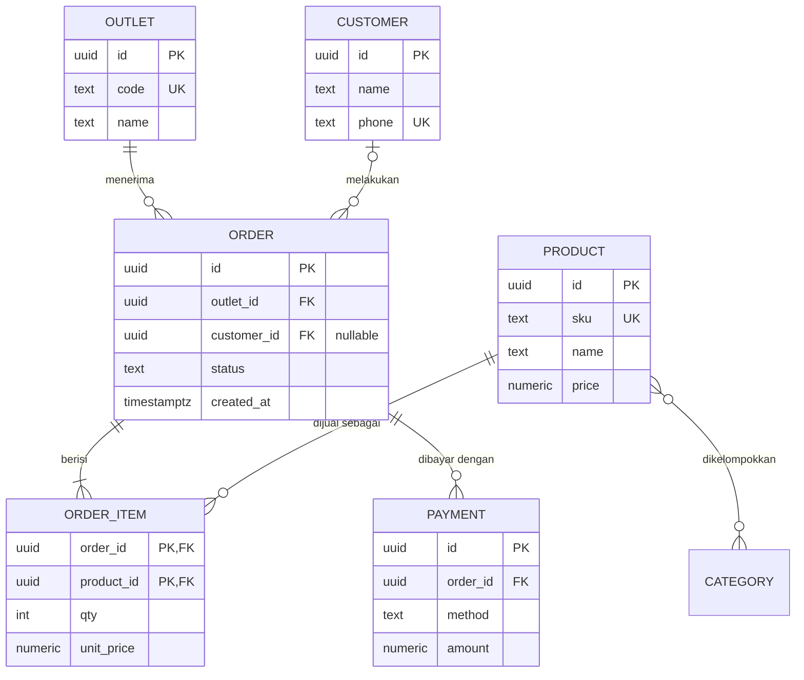

## Overview

**Entity Relationship Diagram (ERD)** adalah gambar model data: **entitas** (hal yang disimpan), **atribut** (detailnya),
dan **relasi** antar entitas beserta **kardinalitas** (berapa banyak). ERD menjembatani kebutuhan bisnis dan skema
database, sehingga kesalahan desain terlihat sebelum ada kode.

## Why It Matters

- Alat komunikasi dengan analis, backend, dan klien ("satu order bisa punya banyak pembayaran?").
- Sering diminta di tes teknis/dokumen proyek (SRS, desain sistem).
- Mempercepat penulisan migrasi dan API yang konsisten.

## Core Concepts

| Elemen | Arti | Contoh |
| --- | --- | --- |
| Entity | Objek/konsep yang datanya disimpan | Customer, Order, Product |
| Attribute | Properti entitas | name, price |
| Key attribute | Identitas | id |
| Relationship | Hubungan antar entitas | Customer *places* Order |
| Cardinality | Jumlah maksimum (1 atau N) | satu customer → banyak order |
| Optionality | Jumlah minimum (0 atau 1) | order boleh tanpa customer (walk-in) |
| Associative entity | Entitas penghubung N:M yang punya atribut | OrderItem (qty, unit_price) |
| Weak entity | Bergantung pada entitas lain untuk identitasnya | OrderItem bergantung pada Order |

### Notasi crow's foot

```text
||  tepat satu          |o  nol atau satu
|<  satu atau banyak    o<  nol atau banyak
Customer |o----o< Order : pelanggan opsional untuk order; pelanggan bisa punya 0..N order
```

Level model: **konseptual** (entitas & relasi saja) → **logis** (atribut, kunci, normalisasi) → **fisik** (tipe data,
index, constraint spesifik DBMS).

## How It Works

```text
1. Baca kebutuhan → tandai kata benda (calon entitas) & kata kerja (calon relasi)
2. Tentukan atribut & identitas setiap entitas
3. Tentukan kardinalitas & opsionalitas dengan bertanya: "Satu X bisa punya berapa Y? Minimal?"
4. Pecah N:M menjadi entitas asosiatif
5. Normalisasi (hilangkan duplikasi/atribut multi-nilai)
6. Validasi dengan skenario nyata & stakeholder → turunkan ke tabel
```

## Implementation

### Contoh ERD POS

```text
OUTLET ||──o< ORDER >o──o| CUSTOMER        (customer opsional: walk-in)
                 │
                 ├──|< ORDER_ITEM >o──|| PRODUCT >o──o< CATEGORY  (via product_categories)
                 │
                 └──o< PAYMENT                         (split payment dimungkinkan)
```

Versi kode Mermaid (simpan di repo; dapat dirender di GitHub, GitLab, atau mermaid.live):



*Relasi N:M PRODUCT–CATEGORY pada tahap fisik dipecah menjadi tabel `product_categories`.*

### Dari ERD ke tabel (aturan pemetaan)

| Pola ERD | Tabel |
| --- | --- |
| Entitas | Tabel dengan PK |
| 1:N | FK di sisi N |
| 1:1 | FK + UNIQUE di sisi yang opsional/bergantung |
| N:M | Tabel penghubung dengan 2 FK (+ atribut relasi) |
| Atribut multi-nilai (beberapa nomor HP) | Tabel anak |
| Opsionalitas 0 | FK nullable |

### Pertanyaan validasi yang perlu diajukan

```text
- Apakah satu order bisa dibayar dengan beberapa metode (split payment)? → ORDER ||--o{ PAYMENT
- Apakah harga di order item perlu disimpan, atau ambil dari produk? → simpan unit_price (harga bisa berubah)
- Apakah produk bisa punya varian (ukuran/rasa)? → entitas PRODUCT_VARIANT
- Apakah stok per outlet? → entitas STOCK_LEVEL (product × outlet)
```

## Best Practices

- **Mulai dari konseptual**, jangan langsung tipe data.
- **Gunakan istilah bisnis** sebagai nama entitas.
- **Tanyakan kardinalitas & opsionalitas secara eksplisit** — sumber bug paling umum.
- **Simpan ERD sebagai kode** (Mermaid/DBML) di repo agar ikut versi.
- **Perbarui ERD bersama migrasi**.

## Anti-Patterns

- ERD yang tidak pernah diperbarui setelah proyek berjalan.
- Entitas "Data" atau "Info" yang menampung segalanya.
- Mengabaikan entitas asosiatif sehingga atribut relasi (qty, harga) tidak punya tempat.
- Menyalin struktur layar UI menjadi tabel.

## Performance Considerations

ERD logis fokus pada kebenaran; pertimbangan performa (index, denormalisasi, partisi) ditambahkan di model fisik
berdasarkan pola query nyata.

## Security Considerations

Tandai atribut sensitif (data pribadi, data pembayaran) di ERD sejak awal agar perlakuan khusus — enkripsi, masking,
pembatasan akses, retensi — direncanakan.

## Real-World Use Cases

- Dokumen desain sistem untuk klien/tender.
- Diskusi kontrak data antara tim mobile dan backend.
- Onboarding engineer baru.

## Interview Questions

1. Apa itu ERD dan elemen-elemennya?
2. Apa beda kardinalitas dan opsionalitas?
3. Bagaimana memetakan relasi many-to-many ke tabel?
4. Apa itu entitas asosiatif?
5. Buat ERD sederhana untuk sistem kasir.

## Sample Answers

1. Diagram model data yang menampilkan entitas, atribut (termasuk kunci), dan relasi beserta kardinalitasnya.
2. Kardinalitas adalah jumlah maksimum (satu atau banyak); opsionalitas adalah jumlah minimum (nol/opsional atau satu/wajib).
3. Buat tabel penghubung berisi FK ke kedua entitas dengan kunci komposit atau UNIQUE pada pasangan.
4. Entitas yang lahir dari relasi N:M dan memiliki atribut sendiri, mis. OrderItem (qty, unit_price) antara Order dan Product.
5. Outlet 1–N Order; Customer 0..1–N Order; Order 1–N OrderItem; Product 1–N OrderItem; Order 1–N Payment; Product N–M Category — jelaskan alasan tiap kardinalitas.

## Practical Exercises

1. Buat ERD untuk sistem tiket gangguan (pelanggan, tiket, teknisi, lampiran, riwayat status).
2. Turunkan ERD POS di atas menjadi DDL PostgreSQL lengkap.
3. Tambahkan varian produk dan stok per outlet ke ERD.

## Quick Reference

```text
Entity · attribute · relationship · cardinality (max) · optionality (min)
Crow's foot: || satu · |o 0..1 · |< 1..N · o< 0..N
1:N → FK di N · 1:1 → FK UNIQUE · N:M → junction · multi-nilai → tabel anak
Konseptual → logis → fisik · simpan sebagai kode (Mermaid/DBML)
```

## Related Topics

- [Primary Key, Foreign Key & Jenis Relasi](/database/keys-relationships/)
- [Normalization & Denormalization](/database/normalization/)
- [Database Schema Design](/database/schema-design/)
